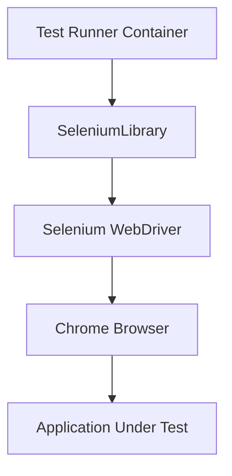
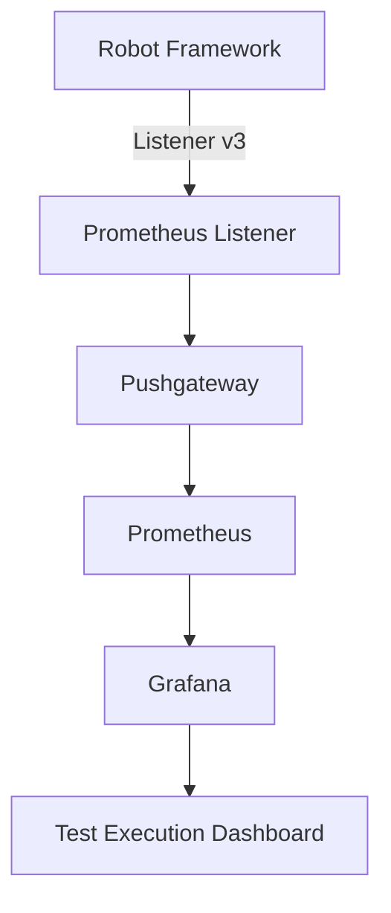
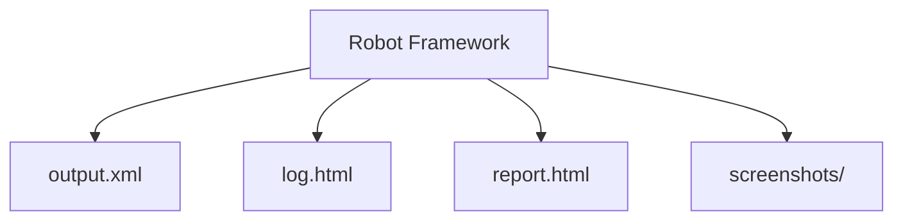
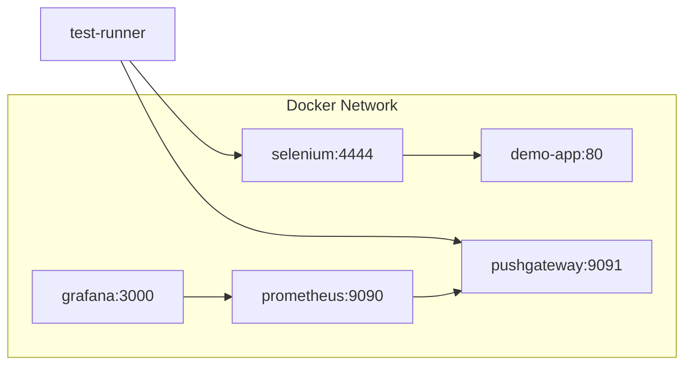

# Phase 0 Architecture

## Overview

Phase 0 establishes the architectural foundation for the AI Testing Automation platform. It demonstrates automated UI test execution, metrics capture, batch telemetry publishing, and real-time visualization using containerized services.

The design isolates test execution from observability while preserving end-to-end traceability from high-level dashboards down to granular failure screenshots.

---

## Architectural Diagrams

### Test Execution Flow

The test runner container executes tests headlessly or against a remote browser grid. Robot Framework delegates browser interactions to SeleniumLibrary, which translates keywords into W3C WebDriver protocol calls sent to the Selenium Standalone container over HTTP.

### Observability Flow

During test execution, Robot Framework's Listener v3 API hooks into test lifecycle events (start suite, end suite, start test, end test). The listener computes execution statistics and pushes them via an abstracted publisher to Prometheus Pushgateway. Prometheus regularly scrapes Pushgateway, and Grafana queries Prometheus to render execution dashboards.

### Native Artifacts Flow

Alongside numeric telemetry, Robot Framework generates native execution artifacts:
- `output.xml`: Machine-readable execution log containing test hierarchy, timestamps, keyword parameters, and status codes.
- `log.html`: Deep diagnostic log detailing keyword-level step timings, arguments, and return values.
- `report.html`: High-level executive test summary.
- `screenshots/`: Automatic full-page captures taken at the exact instant of assertion or keyword failure.

### Docker Services

All components communicate over an isolated Docker bridge network:
- `selenium` (`:4444`, VNC `:7900`): Runs standalone Chrome browser.
- `demo-app` (`:80`): Static local application under test for baseline and smoke verification.
- `pushgateway` (`:9091`): Buffer endpoint for ephemeral test runner metrics.
- `prometheus` (`:9090`): Time-series metrics datastore scraping Pushgateway.
- `grafana` (`:3000`): Web visualizer with pre-provisioned dashboards and datasources.
- `test-runner`: Short-lived CLI/batch container executing the Robot Framework suites.

---

## Architectural Principles & Rationale

### Separation of Concerns

The architecture separates five primary responsibilities:

| Domain | Responsibility | Technology |
|---|---|---|
| **Test Definition** | Human-readable test cases, keywords, and business assertions | Robot Framework syntax (`.robot`) |
| **Test Execution** | Browser orchestration, DOM manipulation, driver interaction | Selenium Standalone Chrome + SeleniumLibrary |
| **Evidence Collection** | Granular failure logs, keyword traces, DOM screenshots | Robot Native Artifacts (`log.html`, `screenshots/`) |
| **Metrics Capture** | High-level operational telemetry (duration, pass/fail counts, status) | Custom Listener v3 + Prometheus Client |
| **Visualization** | Aggregation, cross-run trends, filtering, alerting | Grafana + Prometheus |

This separation ensures that test logic remains independent of the monitoring stack, and the monitoring stack remains agnostic of test implementation details.

### Why Pushgateway (Batch Job Pattern)

Prometheus uses a pull model, expecting monitored endpoints to be long-running HTTP servers exposing a `/metrics` endpoint. However, test automation suites are **short-lived batch jobs**:
- Test runner containers exist only for the duration of the test run.
- When execution finishes, the container terminates immediately.
- Prometheus may not scrape at the exact millisecond the run completes, risking data loss.

Pushgateway acts as a persistent intermediate metric buffer. The test runner pushes its metrics upon completion, and Pushgateway holds them until Prometheus scrapes them according to its regular scrape interval.

### Why MetricsPublisher Abstraction

The test listener does not call `prometheus_client` directly. Instead, it interacts with an abstract interface (`MetricsPublisher`):
- Decouples test lifecycle listening from metric transmission mechanics.
- Allows seamless switching between transports (e.g., Prometheus Pushgateway, OpenTelemetry OTLP collector, InfluxDB line protocol, or local mock for unit testing).
- Isolates network retries, connection errors, and payload formatting from test execution results.

### Test ID Traceability: Grafana → test_id → Robot Report

Every automated test case is assigned an immutable ID (e.g., `TC-POC-001`, `TC-AUTH-002`):
1. **In Dashboard**: Grafana displays a table panel listing failing test cases with their `test_id`, suite, duration, and status.
2. **In Artifacts**: Engineers use the `test_id` to locate the exact test case in `log.html` or grep `output.xml`.
3. **In Evidence**: Failure screenshots are indexed or tagged with the corresponding `test_id`.

This prevents metric aggregation from obscuring the root cause of failures.

### Future: Unified Pipeline for AI-Generated Tests

In subsequent phases, AI planners will parse markdown specifications (`test-suite.md`) and generate either Robot Framework keyword suites or Java/TestNG test classes. 

Because the metrics schema (`qa_*`) and publisher contracts are standardized:
- AI-generated Robot tests emit the exact same metrics.
- Future Java/TestNG test runners will use a matching Java listener publishing to Pushgateway.
- The same Grafana dashboards, Prometheus scrapers, and alerting rules will monitor human-written, AI-generated, Robot, and Java executions without modification.

---

## Component Responsibilities

- **Robot Framework**: Top-level test runner. Manages test lifecycle, parses test suites, executes keywords, aggregates outcomes, and fires listener hooks.
- **SeleniumLibrary**: Translates Robot Framework high-level keywords into Selenium WebDriver commands.
- **Selenium**: Implements the W3C WebDriver protocol in a standalone container; controls Chrome browser instance and returns DOM states.
- **Robot Listener**: Implements Listener v3 API (`start_suite`, `end_suite`, `start_test`, `end_test`). Calculates test durations and aggregate counts, then invokes the publisher.
- **MetricsPublisher**: Interface encapsulating metric serialization, metric registry management, and HTTP transport to Pushgateway.
- **Pushgateway**: Ephemeral metric cache. Stores metrics grouped by project, suite, browser, and test type until overwritten by subsequent runs.
- **Prometheus**: Time-series database. Scrapes Pushgateway on an interval (e.g., 15s) with `honor_labels: true` to preserve job labels.
- **Grafana**: Web interface querying Prometheus. Displays execution summaries, trends, and test case tables via provisioned JSON dashboards.

---

## Extension Points

1. **New Test Types**:
   - Add new labels (e.g., `test_type="api"`, `test_type="performance"`, `test_type="visual"`).
   - Reuses existing Pushgateway, Prometheus, and Grafana pipeline without changes.
2. **New Execution Engines**:
   - For Java (TestNG/JUnit), Playwright, or Cypress: implement a listener that conforms to the `qa_*` metric schema and pushes to Pushgateway.
3. **New Observability Backends**:
   - Implement a new `MetricsPublisher` class (e.g., `OtelMetricsPublisher` or `InfluxDbMetricsPublisher`) without changing any test files or keywords.
4. **New Dashboards & Alerts**:
   - Create additional Grafana dashboards filtering on `project`, `test_type`, or `suite` variables without altering metric collection.
