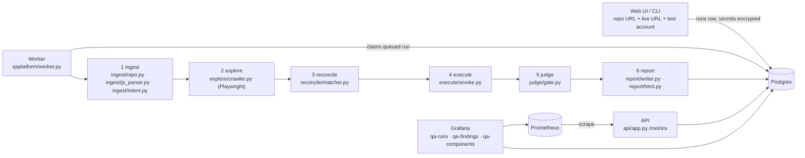

# Architecture (as implemented, Phase 2)

The proposal in `TARGET_ARCHITECTURE.md` is the design; this file is what exists in the code today.

## Data model (Grafana reads these)

| Table | One row per | Key columns |
|---|---|---|
| runs | submitted run | status, stage, progress, stats (coverage, counts), commit_sha, framework |
| run_events | log line | stage, level, message |
| pages | explored page | route, status_code, element_count, console_errors, failed_requests, viewports (layout summary + screenshots) |
| components | interactive component | route, kind, label, source (code / observed / both), selector, intent, action_class, status |
| tests | executed check | technique, category, steps, expected, observed, status, reproduced n/m |
| findings | reported problem | severity, category, title, expected, observed, standard_ref, viewport, confidence, status, evidence |
| review_labels | human verdict on a finding | verdict (true_positive / false_positive) |

## The oracle

`ingest/intent.py` turns each parsed element into an intent: expected behaviours (navigates to X, opens a drawer, submits the form, calls `PATCH /api/...`, ends the session), validation attributes, and an action class. `execute/smoke.py` uses that intent as the pass/fail rule for the smoke click. Elements without a code expectation are judged on error signals only. Route guards use the `ProtectedRoute` fact from the code; logout uses the `logout()` call and the guard together.

## Action classes (`explore/safety.py`)

| Class | Decided by | Smoke click |
|---|---|---|
| safe | links, drawers/menus/toggles, GET-only handlers | yes |
| mutating | submit buttons, POST/PUT/PATCH handlers, save/create/send labels | only with "allow mutations" |
| destructive | DELETE handlers, delete/remove/purge/deactivate/reset labels | never |
| session_ending | logout | once, last, with its own oracle |
| download | file links | not clicked |

## Phase 2 modules (run after the smoke stage, each in its own signed-in browser context)

All of them share `SmokeRunner`: a fresh signed-in context, the write guard (`execute/guard.py`), `prepare(page_url, reveal)` to replay the clicks that reach a component, and `test_component()` (click, judge, re-run twice on failure).

| Module | File | Oracle |
|---|---|---|
| reveal | `execute/reveal.py` | Controls that open things are clicked; newly visible controls are matched to the code's conditional elements (co-location with the opener's file, data-driven labels) and click-tested, two levels deep. New panels: role=dialog, focus inside, Escape closes. |
| destructive | `execute/destructive.py` | Code says the handler opens a confirmation: first click sends nothing and opens it; Cancel sends nothing and closes it. Code shows a destructive call without one: review finding, no click. |
| forms | `execute/forms.py` | Per form found at rest or after a reveal: invalid partitions/boundaries send nothing; valid input sends a write (path matched against the code's API calls); the blocked write produces visible feedback, never a success message or a stuck button. Sign-in: masking, toggle, empty submit, unknown account, enumeration, Enter key. |
| state | `execute/state.py` | Reload, new tab (localStorage sessions), Back/Forward, logout with the request failing, Back after logout, unsaved edits (review). |
| lifecycle | `execute/lifecycle.py` | Controlled clock (`context.clock`): polls at the code's period, stop control stops it, unmount stops it; session-ending timers end the session. |
| faults | `execute/faults.py` | Page-specific reads only (bootstrap reads shared by most pages are left alone): 502 and offline must not blank the page and must explain; Retry must recover; held responses must not produce a false empty state. |

The seeded-bug fixture (`tests/fixture/app.html`) plants ten bugs, one or more per module, next to correct twins; `tests/unit/test_benchmark_fixture.py` runs the real `execute_all()` against it and requires full recall, no unexpected findings, and no write reaching the fixture's server except sign-in and logout.

## Confidence

Deterministic checks (guards, page health, layout) are single observations with confidence 0.9. Click failures are re-run twice: 3/3 → 0.95, 2/3 → 0.8, 1/3 → 0.45. The gate reports at ≥ 0.7; the rest is `needs_review`. Reviewed labels produce the precision figure on the Runs dashboard.
