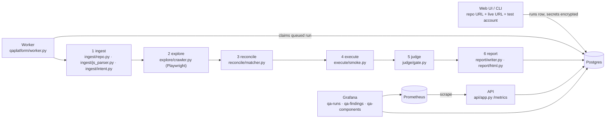

# Architecture (as implemented, Phase 2)

The proposal in `TARGET_ARCHITECTURE.md` is the design; this file is what exists in the code today.

## Native apps (`qaplatform/app/`)

A run's `platform` column selects the pipeline. Web uses `pipeline.run_pipeline` with Playwright. Android, iOS and macOS use `app/pipeline.run_app_pipeline` and share the reporting tables. The Docker worker claims web runs only. `make app-worker-start` runs a host worker for native jobs. Native device jobs need access to the host's Appium server, device and build.

Android's `runs.options.test_mode` selects the work. `frontend` exercises the build without a repository. `backend` checks out the backend source and inventories supported route declarations without opening a device session. `full` combines both. Backend and Full require a submitted HTTPS Git URL and token. Both can verify an explicit GET response and optionally run bounded GET performance checks against an explicit deployed API base URL. Android device jobs use the worker's `MAX_SCREENS` budget.

| Module | Role | Reuses from the web pipeline |
|---|---|---|
| `app/build.py` | Resolve the build: .apk (aapt2 badging), .ipa, .app, .dmg (mounted read-only), or an installed app id | |
| `app/code.py` | React Native screens and controls; Electron menu templates -> `CodeInventory` | tree-sitter helpers and dataclasses from `ingest/js_parser.py` |
| `app/device.py` | Appium session (autostarts Appium / emulator), UI tree -> `ObservedElement`, tap / type / back / rotate / network, crash + ANR + logcat signals | `ObservedElement` |
| `app/explore.py` | Depth-first walk; one `Tap` per safe control; reproduction of failing taps | `explore/safety.classify_action` plus app rules |
| `app/checks.py` | Screen checks, tap results, active device checks, sign-in negatives | `TestRecord`, `FindingRecord`, `judge/gate.py` |
| `app/buildcheck.py` | Checks on the build file itself: manifest flags, signing certificate, exported components, secrets / `http://` URLs in the bundle | `TestRecord`, `FindingRecord` |
| `app/remedy.py` | Fills each finding's `fix_in`, `fix`, `code_ref` (path:line) and `steps` | `CodeInventory`, `ComponentRecord` |
| `app/backend.py` | Backend route declarations with mount prefixes and auth hints, plus client endpoint discovery when app source is available. Backend source stays outside UI coverage. | |
| `app/assertions.py` | One user-defined observed screen-text expectation and one user-selected GET response expectation | `TestRecord` |
| `app/testdata.py` | QA values (`qa_<run>_<time>`), ownership on screen (row / record screen showing this run's value), the `qa_data.json` ledger | `app/device.Snapshot` |
| `app/journeys.py` | Journey plan from the code, safety validation (effect of each step from the code; LLM may only raise it), runner on the device, cleanup | `explore/safety`, `app/explore` navigation |
| `app/ai.py` | LLM screen intent, journeys and validation cases; second look at journey results (`needs_review` only). No credentials in prompts | `ingest/intent._generate_json`, `_strip_secrets` |
| `app/loadtest.py` | Bounded GET-only backend load test with a shared rate limiter | `TestRecord`, `FindingRecord` |
| `app/pipeline.py` | The seven stages | `reconcile/matcher.reconcile`, `pipeline.build_components`, `report/writer.persist`, `report/html.write_report` |

The Android form records a single `backend` entry in `runs.options.codebase_sources` when source is required. Source-assisted iOS and macOS runs can record a `frontend` entry and an optional `backend` entry. Repository and API assertion credentials are encrypted separately from run options and cleared at terminal completion. `ingest/workspace.py` gives each worker attempt a private temporary checkout directory. The API serves the `runs` directory, and the worker writes backend route counts to `runs.stats` and detailed declarations to `backend.json`. Android stores outcomes under `runs.stats.legs` and writes assertions, journeys and load results to the shared test rows. Full runs retain the backend result if device work stops and continue device work after a checkout failure. Prometheus exposes `qa_latest_load_test` and `qa_latest_journeys`.

An observed screen becomes an `ObservedPage` whose route is the code screen it is: the screen the tapped control navigates to in the code, else the one whose title it shows, else the one with the most labels and texts only it has; a panel opened in place keeps its parent's route; `screen:<heading>` when nothing matches. The page URL is `app://<app id>/<route>#<screen signature>`.

## Data model (Grafana reads these)

| Table | One row per | Key columns |
|---|---|---|
| runs | submitted run | platform (web / android / ios / macos), status, stage, progress, stats (coverage, counts), commit_sha, framework |
| run_events | log line | stage, level, message |
| pages | explored page | route, status_code, element_count, console_errors, failed_requests, viewports (layout summary + screenshots) |
| components | interactive component | route, kind, label, source (code / observed / both), selector, intent, action_class, status |
| tests | executed check | technique, category, steps, expected, observed, status, reproduced n/m |
| findings | reported problem | severity, category, title, expected, observed, standard_ref, viewport, confidence, status, evidence, fix_in, fix, code_ref, steps |
| review_labels | human verdict on a finding | verdict (true_positive / false_positive) |

## The oracle

`ingest/intent.py` turns each parsed element into an intent: expected behaviours (navigates to X, opens a drawer, submits the form, calls `PATCH /api/...`, ends the session), validation attributes, and an action class. `execute/smoke.py` uses that intent as the pass/fail rule for the smoke click. Elements without a code expectation are judged on error signals only. Route guards use the `ProtectedRoute` fact from the code; logout uses the `logout()` call and the guard together.

## Action classes (`explore/safety.py`)

| Class | Decided by | Smoke click |
|---|---|---|
| safe | links, drawers/menus/toggles, GET-only handlers | yes |
| mutating | submit buttons, POST/PUT/PATCH handlers, save/create/send labels | only with "allow mutations" |
| destructive | DELETE handlers, delete/remove/purge/deactivate/reset labels | never |
| session_ending | logout | once, last, with its own oracle |
| download | file links | not clicked |

## Phase 2 modules (run after the smoke stage, each in its own signed-in browser context)

All of them share `SmokeRunner`: a fresh signed-in context, the write guard (`execute/guard.py`), `prepare(page_url, reveal)` to replay the clicks that reach a component, and `test_component()` (click, judge, re-run twice on failure).

| Module | File | Oracle |
|---|---|---|
| reveal | `execute/reveal.py` | Controls that open things are clicked; newly visible controls are matched to the code's conditional elements (co-location with the opener's file, data-driven labels) and click-tested, two levels deep. New panels: role=dialog, focus inside, Escape closes. |
| destructive | `execute/destructive.py` | Code says the handler opens a confirmation: first click sends nothing and opens it; Cancel sends nothing and closes it. Code shows a destructive call without one: review finding, no click. |
| forms | `execute/forms.py` | Per form found at rest or after a reveal: invalid partitions/boundaries send nothing; valid input sends a write (path matched against the code's API calls); the blocked write produces visible feedback, never a success message or a stuck button. Sign-in: masking, toggle, empty submit, unknown account, enumeration, Enter key. |
| state | `execute/state.py` | Reload, new tab (localStorage sessions), Back/Forward, logout with the request failing, Back after logout, unsaved edits (review). |
| lifecycle | `execute/lifecycle.py` | Controlled clock (`context.clock`): polls at the code's period, stop control stops it, unmount stops it; session-ending timers end the session. |
| faults | `execute/faults.py` | Page-specific reads only (bootstrap reads shared by most pages are left alone): 502 and offline must not blank the page and must explain; Retry must recover; held responses must not produce a false empty state. |

The seeded-bug fixture (`tests/fixture/app.html`) plants ten bugs, one or more per module, next to correct twins; `tests/unit/test_benchmark_fixture.py` runs the real `execute_all()` against it and requires full recall, no unexpected findings, and no write reaching the fixture's server except sign-in and logout.

## Confidence

Deterministic checks (guards, page health, layout) are single observations with confidence 0.9. Click failures are re-run twice: 3/3 → 0.95, 2/3 → 0.8, 1/3 → 0.45. The gate reports at ≥ 0.7; the rest is `needs_review`. Reviewed labels produce the precision figure on the Runs dashboard.

## Workers

`qaplatform/heartbeat.py`: every worker rewrites `artifacts/workers/<host>-<pid>.json` every 5 s (platforms, current run). The API reads these to tell a queued run nobody can claim (the run page shows the command to start a worker). A worker re-queues, at start and every 30 s while idle, any claimed or running run of its platforms that no live worker reports; SIGTERM ends a run through its `finally` blocks (Appium session closed, network restored), and the run is re-queued with its credentials.
