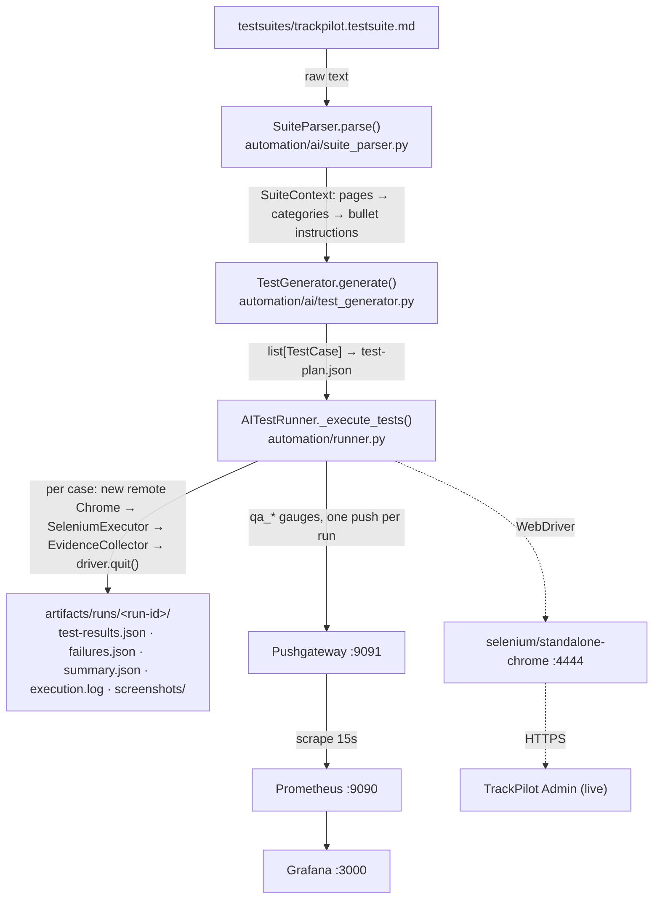
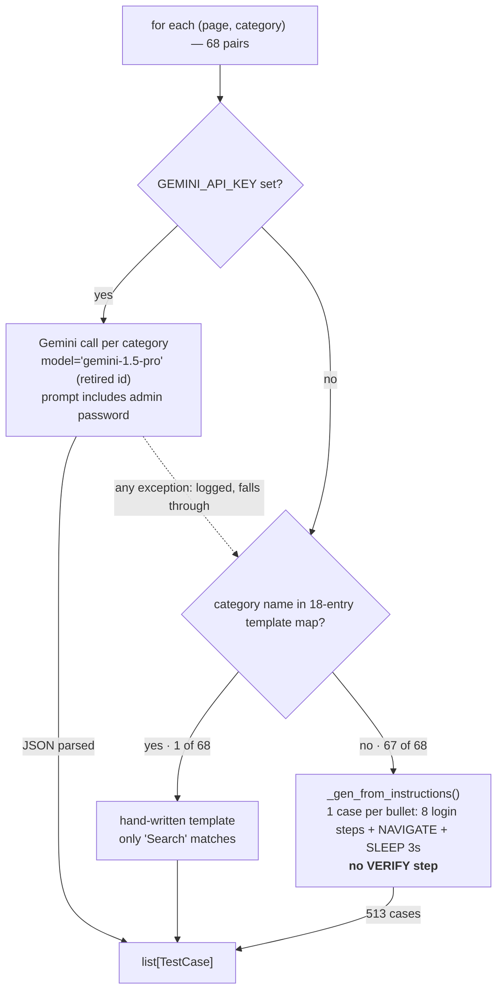
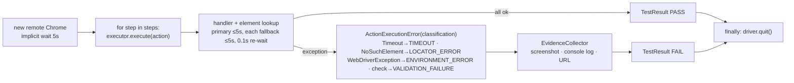

# Current State Audit (pre-refactor baseline, 2026-10-14)

Companion to the visual flow page. This file records how the code works *today* and what is broken, so the refactor has a baseline to measure against.

## Dry-run numbers (no Gemini key, same code the container runs)

| Measure | Value |
|---|---|
| Page sections parsed | 11 |
| Categories found | 68 |
| Categories matching a template generator | 1 ("Search") |
| Test cases generated | 514 |
| Cases containing any `VERIFY_*` step | 1 |
| Estimated serial run time (new browser + login per case) | ~2.5 h |

## Runtime flow

## Generator decision path (the critical mechanism)

## Per-case execution

## Findings, ranked

| Sev | Finding | Where | Effect |
|---|---|---|---|
| critical | Per-bullet fallback emits login + navigate + sleep with no assertion | `automation/ai/test_generator.py:898` | 513/514 cases pass whenever login works |
| critical | Template map keys don't match the suite's category headings | `automation/ai/test_generator.py:146` | Login/validation/security/session/logout generators never run |
| critical | `gemini-1.5-pro` is a retired model id; exceptions are swallowed and fall through (verify with a key) | `automation/ai/test_generator.py:223` | With a key, same no-assert plan, silently; 68 uncached calls per run |
| high | Admin email + password interpolated into the Gemini prompt | `automation/ai/test_generator.py:181` | Credentials leave the environment |
| high | Fresh browser + full login per case, serial, fixed sleeps; no page/tag/priority filter, no dry-run | `automation/runner.py:215` | 2–3 h per run |
| high | Robot listener calls `publish_test_result` without required kwargs (`test_name`, `page`, `functionality`, `run_id`) | `automation/listeners/prometheus_listener.py:117` | `make test-robot` raises TypeError in the listener |
| high | `STATUS_MAP` key `SKIP` vs `TestStatus.SKIPPED`; `BLOCKED` unmapped | `automation/metrics/publisher.py:84` | Skipped/blocked recorded as FAIL (0) |
| high | Parser drops sections 17–23 and all "Visible Functionality" blocks; credential/global-rule parsers are stubs | `automation/ai/suite_parser.py:127` | No logout, global nav, cross-page, console-error tests; priorities ignored |
| high | "Inspect actual UI" step from the suite has no implementation | `automation/ai/test_generator.py:100` | Locators are guessed, never discovered |
| medium | Fallback lookup: 5 s per locator then 0.1 s re-wait to raise; plus implicit wait | `automation/actions/executor.py:292` | Missing element costs 30 s+, misclassified TIMEOUT |
| medium | Hard-coded `/live-activity`, `/time-history` vs suite `/live`, `/history` | `automation/ai/test_generator.py:733` | Navigation template would fail anyway |
| medium | Gauges replaced per push under one grouping key | `automation/metrics/publisher.py:187` | No run history; "trend" panels show last run only |
| medium | No `goog:loggingPrefs` capability on Chrome options (verify) | `automation/runner.py:112` | Console-error evidence likely always empty |
| medium | Docs/config drift: demo-app referenced but absent; `TRACKPILOT_*` vs `BASE_URL`/`VALID_USER_*`; `login.robot` cites a missing `testcases.md` | `docs/`, `scripts/`, `tests/` | Onboarding points at missing pieces |
| low | `update_generator.py`: one-off patch with another developer's absolute path, already applied | `update_generator.py:4` | Delete |
| low | `pydantic` unused; `google-genai` unpinned; Robot/SeleniumLibrary only for legacy suite; `Locator.to_selenium_locator` dead; `Action.to_dict` drops fallbacks | `requirements.txt`, `automation/actions/schema.py` | Bloat, unreproducible, plan JSON incomplete |
| low | No unit tests, lint or pyproject; `run-suite.sh` `set -e` hides its FAILED branch | repo root | No safety net for the refactor |

## Worth keeping

- The layering: parser → generator → action schema → executor → evidence → publisher.
- The action vocabulary (35 types, 8 locator strategies, primary + fallback locators), serialisable to JSON.
- Exception-to-classification mapping and the evidence collector.
- Compose infra with health checks, provisioned Prometheus datasource and Grafana dashboard, swappable `MetricsPublisher`.

## Local environment (installed 2026-10-14)

- `.venv` on Python 3.12.13 with all pinned requirements.
- Docker images pulled: selenium/standalone-chrome 4.49.0, prom/pushgateway v1.11.3, prom/prometheus v3.14.0, grafana/grafana 13.2.2.
- `ai-testautomation-test-runner:latest` built.
- `.env` created from `.env.example`; `GEMINI_API_KEY`, `VALID_USER_EMAIL`, `VALID_USER_PASSWORD` still blank.
- Infra containers not started (`make up` when needed).
